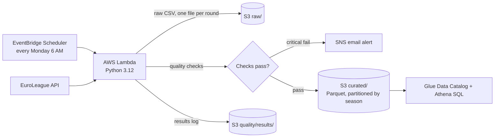

# EuroLeague Stats Pipeline

A serverless data pipeline on AWS that pulls EuroLeague basketball box scores every week, checks the data for problems, cleans it, and makes it queryable with SQL.

**Built with:** Python · AWS Lambda · Amazon S3 · Amazon Athena · AWS Glue Data Catalog · Amazon EventBridge Scheduler · Amazon SNS · pandas · Parquet · pytest

---

## What it does

Every Monday at 6 AM ET, an EventBridge schedule starts a Lambda function that:

1. **Ingests:** checks which rounds are already saved in S3, then pulls only new rounds from the EuroLeague API (incremental load).
2. **Validates:** runs 5 data quality checks before anything is saved. Critical failures stop the run; any failure sends an email alert.
3. **Transforms:** cleans the raw data, splits player rows from team totals, and writes partitioned Parquet files.
4. **Serves:** the curated data is queryable in Amazon Athena with standard SQL.

## Architecture



## Data

| Season | Games | Raw rows | Player rows | Team-total rows |
|---|---|---|---|---|
| 2023-24 | 331 | 9,207 | 7,883 | 662 |
| 2024-25 | 330 | 9,183 | 7,863 | 660 |
| 2026-27 (in progress, through round 13) | 130 | 3,631 | 3,111 | 260 |

Every season reconciles: player rows + team-total rows + dropped "Team" helper rows = raw rows.

## S3 layout

```
s3://dlogan-euroleague-data/
  raw/boxscores_rounds/season=2026/round=01.csv   # one file per round (incremental)
  raw/boxscores/season=2026/boxscores.csv         # full season, rebuilt each run
  curated/boxscores/season=2026/boxscores.parquet # one row per player per game
  curated/team_totals/season=2026/team_totals.parquet
  quality/results/season=2026/weekly_<timestamp>.csv
  athena-results/
```

Raw data is never overwritten by the transform step, so any bug can be fixed and rerun from the source.

## Data quality checks

| Check | Rule | Severity |
|---|---|---|
| row_count | The season file never shrinks between runs | Critical: stop the run |
| required_fields | No player row is missing player ID, game or team | Critical: stop the run |
| duplicates | One row per player per game | Critical: stop the run |
| valid_ranges | No negative stats; no more than 50 minutes in a game | Warning: alert, keep going |
| points_reconcile | Each team's player points add up to its team total | Warning: alert, keep going |

Results from every run are saved to `quality/results/`. A planned fire drill (`{"fire_drill": true}` test event) injects a duplicate row and a negative score to prove the checks and the email alert work. See [docs/incident_log.md](docs/incident_log.md).

## Example analysis (Athena SQL)

Queries live in [`sql/analysis.sql`](sql/analysis.sql):

- Top 10 scorers by season
- Most improved scorers between seasons (CTE + self-join on player ID, so players who changed teams still match)
- Most efficient scorers by true shooting %
- Home vs. away scoring by team (conditional aggregation)
- Reconciliation: player points vs. team totals across every game (returns 0 rows)

## Engineering decisions

- **Rate limiting:** the first full-season pull hit HTTP 429 (Too Many Requests) errors and silently skipped games. I switched to pulling round by round with a 20-second pause, which loaded every game with no errors.
- **Incremental loads:** the weekly run re-checks the last saved round (games may still have been in progress) and fetches only new rounds, so it finishes in under a minute instead of re-downloading the season.
- **Partitioning + Parquet:** data is split into `season=` folders so Athena reads only the season a query asks for, and Parquet keeps files small and fast to scan.
- **Cross-platform packaging:** Lambda runs on Linux, so dependencies are installed for `manylinux` / Python 3.12 from a Mac ([`build_lambda.sh`](build_lambda.sh)). pandas comes from the AWS SDK for pandas Lambda layer.
- **Least privilege:** the Lambda role can only read, write and list one S3 bucket and publish to one SNS topic.

## Project structure

```
ingest/       ingest.py: full-season backfill; test_connection.py
transform/    transform.py: cleaning and Parquet output; explore.py
quality/      checks.py: the 5 data quality checks
pipeline/     handler.py: the Lambda entry point (weekly run + fire drill)
sql/          create_tables.sql, analysis.sql
tests/        test_checks.py: pytest unit tests
docs/         incident_log.md
build_lambda.sh
```

## Run it

```bash
python3 -m venv .venv && source .venv/bin/activate
pip install -r requirements.txt

# Backfill a past season
python ingest/ingest.py --season 2024
python transform/transform.py --season 2024

# Run the weekly pipeline locally
PYTHONPATH=transform:quality python pipeline/handler.py

# Unit tests
pytest tests/ -v

# Build the Lambda package
bash build_lambda.sh
```

## What I'd add next

- dbt models for the SQL transformations
- An Apache Airflow DAG version of the pipeline
- A dashboard (Amazon QuickSight) on top of the Athena tables
- Infrastructure as code (AWS CDK or Terraform) instead of console setup

---

Built by David Logan, a former professional basketball player (EuroLeague and top European leagues, 2005–2024) now working in data engineering. [LinkedIn](https://linkedin.com/in/davidloganbasketball)
